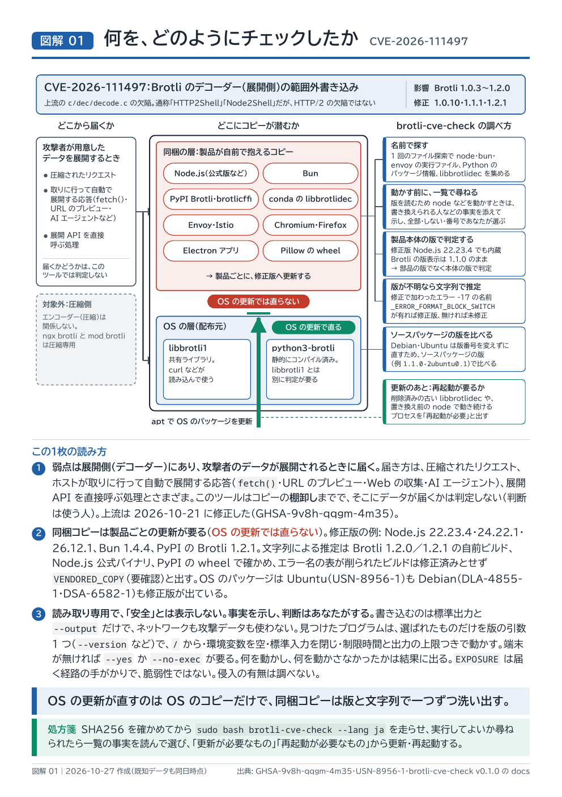
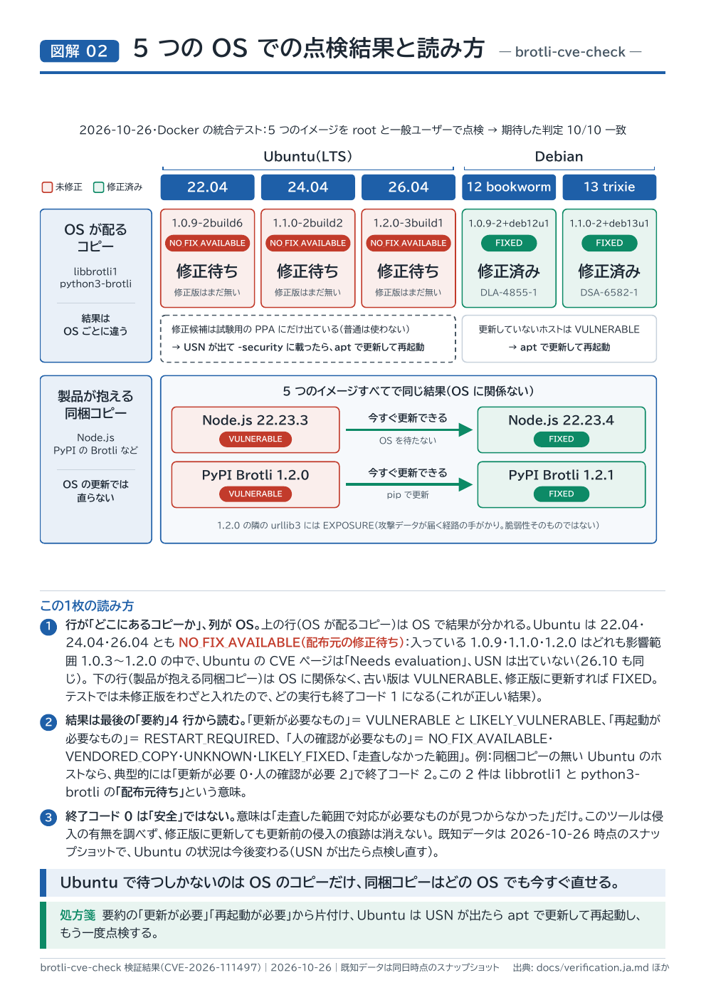

# brotli-cve-check

Ubuntu・Debian のホスト 1 台の中から、**CVE-2026-111497**（Google Brotli のデコーダー
`c/dec/decode.c` の範囲外書き込み。Brotli 1.0.3〜1.2.0 が該当、1.0.10・1.1.1・1.2.1 で修正）に
該当しうる Brotli **デコーダー**のコピーを洗い出す、読み取り専用のシェルスクリプトです。

キーワード: CVE-2026-111497、GHSA-9v8h-qqgm-4m35、Brotli デコーダー、「HTTP2Shell」「Node2Shell」
（通称に HTTP/2 とありますが、HTTP/2 の欠陥ではありません）。

English: [README.md](README.md) / 医療機関・中小企業の方へ: [docs/for-clinics.ja.md](docs/for-clinics.ja.md)
（docs/ の文書は英語版の隣に日本語版 `*.ja.md` があります）

## ひと目でわかる図解

<table>
<tr>
<td width="50%" valign="top"><a href="docs/zukai/01_check-method_ja.pdf"></a></td>
<td width="50%" valign="top"><a href="docs/zukai/02_results-reading_ja.pdf"></a></td>
</tr>
<tr>
<td><b>図解 01 何を、どのようにチェックしたか</b><br>OS の更新が直すのは OS のコピーだけ。同梱コピーは版と文字列で一つずつ洗い出す。<br><a href="docs/zukai/01_check-method_ja.pdf">PDF</a> · <a href="docs/zukai/01_check-method_ja.html">HTML</a></td>
<td><b>図解 02 5 つの OS での点検結果と読み方</b><br>Ubuntu で待つしかないのは OS のコピーだけ。同梱コピーはどの OS でも今すぐ直せる（2026-10-26 時点）。<br><a href="docs/zukai/02_results-reading_ja.pdf">PDF</a> · <a href="docs/zukai/02_results-reading_ja.html">HTML</a></td>
</tr>
</table>

英語版: [Fig. 01](docs/zukai/01_check-method_en.pdf)、[Fig. 02](docs/zukai/02_results-reading_en.pdf)。
検証結果の全体: [docs/verification.ja.md](docs/verification.ja.md)。

## このツールがすること・しないこと

**すること**

- 配布元パッケージ（`libbrotli1`、`python3-brotli` など）を、配布元の修正版と比べる
- OS のパッケージを更新しても**直らない**コピーを探す: Node.js、Bun、PyPI の `Brotli`／`brotlicffi`、
  conda、Envoy、curl、ブラウザ、snap/flatpak のアプリ、パッケージ管理外の `libbrotlidec`、
  そして（`--deep` で）デコーダーを抱えた任意の ELF ファイル
- 更新後も古いコードで動き続けているプロセス（再起動が必要なもの）を探す
- 露出のヒントを出す（Brotli を自動で展開する HTTP クライアント、待ち受けポート）

**しないこと**

- 侵入の有無は調べません。修正版に更新しても、更新前の侵入の痕跡は消えません
- 他のホストの走査、ネットワークへのアクセス、インストール・更新・再起動・変更は一切しません
- 攻撃データを作らず、取得せず、同梱もしません
- 「安全」とは表示しません。最も良い結果でも「走査した範囲では既知の脆弱な部品は見つからなかった」
  とし、走査しなかった範囲を必ず並べます

## 使い方

`curl | bash` はしないでください。ダウンロード → SHA256 の確認 → 中身を読む → 実行、の順です。

```sh
VERSION=v0.1.0
BASE=https://github.com/sakai-sktech/brotli-check/releases/download/$VERSION
curl -fsSLO "$BASE/brotli-cve-check"
curl -fsSLO "$BASE/SHA256SUMS"
sha256sum -c SHA256SUMS          # 「brotli-cve-check: OK」と出ること
less brotli-cve-check            # 実行するものを読む
bash brotli-cve-check --lang ja            # 一般ユーザーで
sudo bash brotli-cve-check --lang ja       # root で（他ユーザーのプロセスとホームも対象になる）
```

よく使うオプション:

```sh
bash brotli-cve-check --json --output report.json   # 機械向け（docs/json-schema.ja.md）
bash brotli-cve-check --no-exec                     # 見つけたプログラムを一切実行しない
sudo bash brotli-cve-check --deep --containers      # 時間はかかるが広く探す
bash brotli-cve-check --help
```

必要なもの: bash 4.2 以上、coreutils、findutils、grep、sed、awk。binutils（`readelf`）は任意で、
無い場合は一部のリンクの判定の精度が落ち、結果にその旨が出ます。Python もネットワークも使いません。

## 結果の読み方

所見は 1 件 1 行です。

```
[判定] 項目ID | 部品 | 場所 | 版 | 理由 | 次にやること
```

| 判定 | 意味 | 次にやること |
|---|---|---|
| `VULNERABLE` | 既知の脆弱な版 | 更新する（行に更新先が書いてある） |
| `RESTART_REQUIRED` | 修正はディスク上にあるが、古いコードで動き続けているプロセスがある | そのプロセス（サービス）を再起動する |
| `NO_FIX_AVAILABLE` | 配布元が修正版をまだ出していない | 待つ。待つ間は同梱コピーのある製品を優先して更新する |
| `VENDORED_COPY` | デコーダーを抱えているが、版を特定できない | 同梱している Brotli の版を提供元に確認する |
| `LIKELY_VULNERABLE`／`LIKELY_FIXED` | デコーダーの文字列からの推定（検証済み。下記） | 提供元に確認する |
| `UNKNOWN` | 判定できない。理由は必ず書いてある | 理由を読む |
| `EXPOSURE` | 攻撃者のデータがデコーダーに届く経路の手がかり。それ自体は脆弱性ではない | 指している更新を優先する |
| `NOT_APPLICABLE` | そのファイルにはデコーダーがない（圧縮専用のモジュールなど） | そのファイルについては不要 |
| `FIXED` | 修正を含む | 不要 |

最後に、専門家でない人向けの 4 行（「更新が必要なもの」「再起動が必要なもの」「人の確認が必要なもの」
「走査しなかった範囲」）と、侵入についての注意が出ます。

終了コード: `0` 走査した範囲で対応が必要なものは見つからなかった（安全の証明ではない）、
`1` `VULNERABLE` または `RESTART_REQUIRED` がある、`2` 人の確認が必要なものがある
（`NO_FIX_AVAILABLE`・`VENDORED_COPY`・`LIKELY_*`・`UNKNOWN`）、`3` ツール自体のエラー。

## 版の判定方法

版番号をそのまま信じません。

- Debian・Ubuntu は上流の版番号を変えずに修正を取り込みます。**ソースパッケージの版**
  （`1.1.0-2+deb13u1`）を配布元の修正版と比べます。
- 修正版の Node.js 22.23.4 でも `process.versions.brotli` は `"1.1.0"` のままです。この値は使わず、
  Node.js 本体の版で判定します。
- 配布元の `python3-brotli` は静的にコンパイルされているので、`libbrotli1` とは別に判定します。
- 版が分からない同梱コピーは、デコーダーのエラー名の文字列で推定します。修正で
  `_ERROR_FORMAT_BLOCK_SWITCH`（エラー -17）が追加されたためです。1.2.0 と 1.2.1 のビルド
  （共有・静的・LTO、strip の有無）、Node.js の公式バイナリ、PyPI の wheel で検証しました
  （[tests/fixtures/c09/README.md](tests/fixtures/c09/README.md)）。リンカがエラー名の表を削った場合は
  `VENDORED_COPY` とし、修正済みとは判定しません。
- 見つけたプログラムを実行するのは版を尋ねるときだけで、環境変数を空にし、制限時間を付けます。
  さらに、root（または実行者）以外が置き換えられない場所にあるものに限ります。それ以外と `--no-exec`
  のときは、ファイル（ヘッダー・パッケージの記録・パス・文字列）から判定します。

## 限界

[docs/limitations.ja.md](docs/limitations.ja.md) を参照してください。要点: アーカイブの中や、動いていない
イメージの中のコピーは見落としうる／root でないと他ユーザーのプロセスとホームは見えない／既知データは
ある時点のスナップショット。

## 既知データとその日付

既知の版はすべて [data/advisories.tsv](data/advisories.tsv) にあり、各行に一次資料の URL と取得日が
付いています。結果には既知データの日付が出て、30 日以上古ければ警告します。新しいデータは `--data FILE`
で差し替えられます。スナップショット: **2026-10-26**（この時点で Ubuntu・Red Hat などは修正版を
出していません）。

注意: Red Hat の RHSA-2026:2042／2227／2389 は別件（CVE-2025-6176）です。`pip`・`certifi` の更新は
本件と無関係です（CPython 本体は Brotli を含みません）。

## 開発

```sh
make lint          # shellcheck（警告ゼロ）
make test          # bats の単体テスト
make dist          # dist/brotli-cve-check（1 ファイル版）と dist/SHA256SUMS
make integration   # Ubuntu 22.04/24.04/26.04、Debian 12/13 のコンテナ（docker が必要）
```

検証結果: [docs/verification.ja.md](docs/verification.ja.md)。出力例: [docs/sample-output.md](docs/sample-output.md)。
設計メモ: [docs/design.ja.md](docs/design.ja.md)。貢献の手引き: [CONTRIBUTING.md](CONTRIBUTING.md)。
このツール自体のセキュリティ問題: [SECURITY.md](SECURITY.md)。

## 免責

無保証で提供します（[LICENSE](LICENSE)）。結果は、走査した範囲と既知データの日付の範囲でしか
意味を持たず、ホストが安全であることを証明するものではありません。

## ライセンス

MIT。Copyright (c) 2026 株式会社ジェイ・メディック
