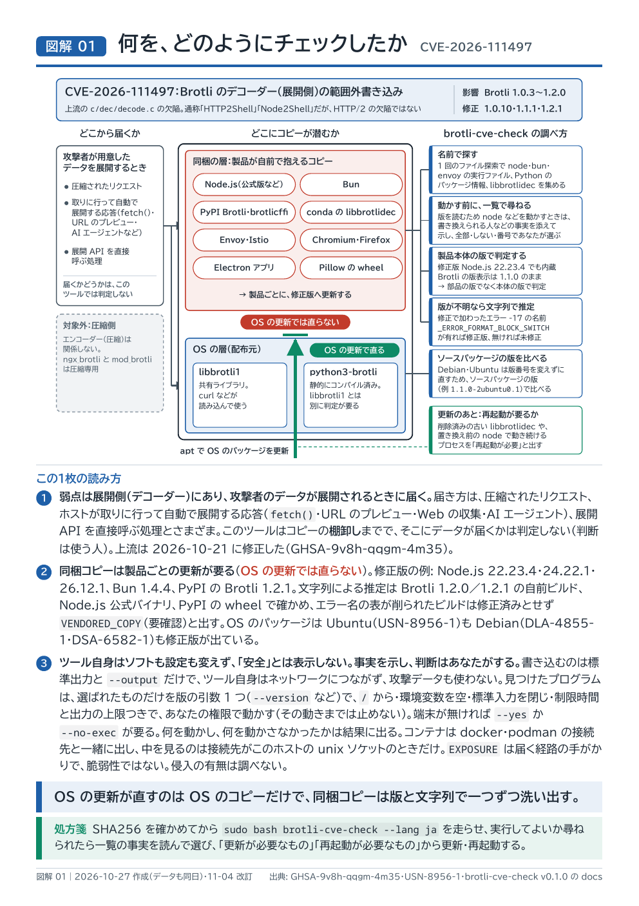
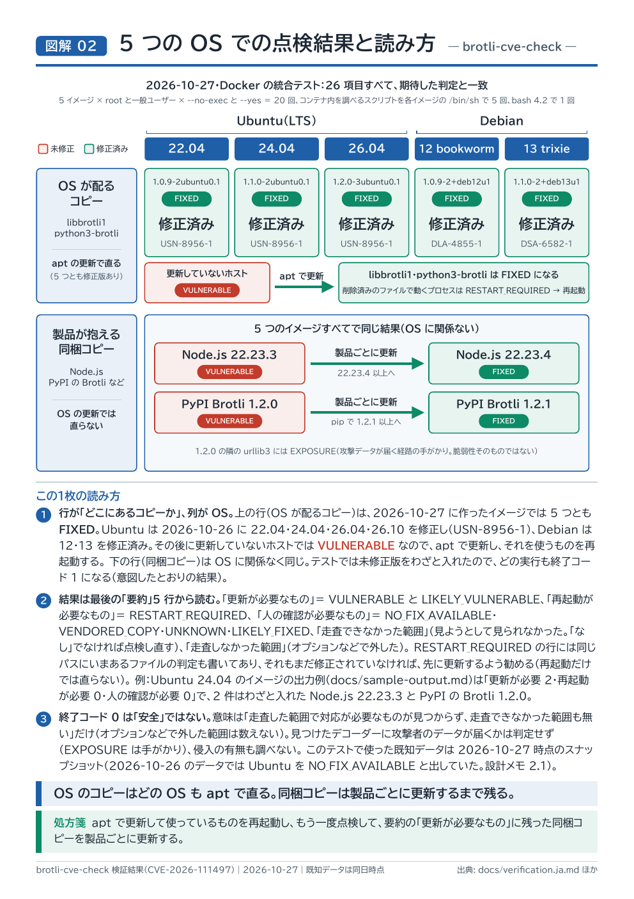

# brotli-cve-check

**CVE-2026-111497**（Google Brotli のデコーダー `c/dec/decode.c` の範囲外書き込み）の影響を受けうる Brotli
**デコーダー**のコピーを、Ubuntu・Debian のホスト 1 台の中から洗い出し、版と文字列を根拠に、更新や確認が要る
ものを並べるシェルスクリプトです。

影響を受けるのは Brotli 1.0.3〜1.0.9、1.1.0、1.2.0 です（勧告の範囲 1.0.3〜1.2.0 のうち、修正版の 1.0.10 と
1.1.1 を除いたもの）。修正版は 1.0.10・1.1.1・1.2.1 です。Debian・Ubuntu は版番号を変えずに修正を取り込むので、
配布元のパッケージは配布元の修正版で判定します。

キーワード: CVE-2026-111497、GHSA-9v8h-qqgm-4m35、Brotli デコーダー、「HTTP2Shell」「Node2Shell」
（通称に HTTP/2 とありますが、HTTP/2 の欠陥ではありません）。

脆弱性の中身、攻撃者のデータがデコーダーに届く経路、自分に関係するかの判断のしかたは、株式会社ジェイ・メディックの
技術解説 [HTTP2Shell／Node2Shell — Brotli の脆弱性で何を確認するか](https://www.jmedic.co.jp/pubdoc/http2shell_report_20261027.html) を参照してください。このツールは、
その次の一歩として、ホスト 1 台の中を棚卸しします。

English: [README.md](README.md) / 医療機関・中小企業の方へ: [docs/for-clinics.ja.md](docs/for-clinics.ja.md)
（docs/ の文書は英語版の隣に日本語版 `*.ja.md` があります）

## このツールで分かること・分からないこと

**分かること**

- ホストの中のどこに Brotli デコーダーのコピーがあり、それぞれが修正版かどうか。配布元のパッケージ
  （`libbrotli1`、`python3-brotli` など）だけでなく、OS を更新しても**直らない**同梱コピー（Node.js、Bun、
  .NET のランタイムと self-contained の .NET アプリ、PyPI の `Brotli`／`brotlicffi`、conda、Envoy、ブラウザ、
  snap/flatpak のアプリ、パッケージ管理外の `libbrotlidec` など）も探します
- 更新したあとも、削除済みの古いファイルを使い続けているプロセス
- 判定できなかったものと、その理由。見なかった範囲と、見ようとしたのに見られなかった範囲（「走査しなかった範囲」「走査できなかった範囲」
  として必ず並べます）

**分からないこと（判定しないこと）**

- 見つけたデコーダーに、攻撃者が用意したデータが届くかどうか。データは、圧縮されたリクエストとして届くことも、
  ホストが外へ取りに行って自動で展開する応答（`fetch()`、URL のプレビュー、Web の収集、AI エージェント）として
  届くことも、展開 API を直接呼ぶ処理を通ることもあります。どれが自分のサービスに当てはまるかは、使う人が
  判断してください。`EXPOSURE` の所見は手がかりで、届くことの確認ではありません。出ないことも、届かないことの確認ではありません
- 攻撃が成功するか、侵入があったか。修正版に更新しても、更新前の侵入の痕跡は消えません
- ホスト全体が安全かどうか。いちばん良い結果でも「走査した範囲では既知の脆弱な部品は見つからなかった」で、
  走査しなかった範囲が一緒に出ます

このツール自身は、ソフトのインストール・更新・停止・設定の変更をしません。書き出すのは標準出力と、`--output`
で指定した新しいファイルだけです（隣に一時ファイルを作ってから消します）。攻撃データを作らず、取得せず、同梱もしません。ただし、版を読むために実行を
許したプログラムは、あなたの権限で動きます（「[版を読むための実行](#版を読むための実行)」）。

## 対象と対応環境

動かすのは、点検するサーバーの管理担当者です。医療機関・中小企業で結果を受け取る方は
[docs/for-clinics.ja.md](docs/for-clinics.ja.md) を読んでください。

点検したいサーバーごとに、そのサーバーの上で動かします。ほかのホストには入りません。Docker は要りません
（コンテナを見るときだけ使います）。

| 環境 | 説明 |
|---|---|
| Ubuntu・Debian のホスト | 主な対象。配布元パッケージを判定できる系列は、同梱の既知データにあるもの |
| 確かめた環境 | Ubuntu 22.04・24.04・26.04、Debian 12・13 の x86_64 のコンテナ（[docs/verification.ja.md](docs/verification.ja.md)）と、開発者の作業端末（Ubuntu 24.04）。Ubuntu 26.10 は既知データにあるが、統合試験には入っていない |
| Ubuntu・Debian の派生（Linux Mint など） | os-release の `UBUNTU_CODENAME`・`DEBIAN_CODENAME` で元の系列が分かれば、その系列で判定する。統合試験には入っていない |
| ほかの Linux（RHEL 系など） | 試していない。配布元パッケージの判定はしない |
| Windows・macOS | 対象外 |
| WSL・仮想マシン・コンテナの中 | その中で見える範囲だけを見る。外側のホストの結果にはならない |

## ひと目でわかる図解

<table>
<tr>
<td width="50%" valign="top"><a href="docs/zukai/01_check-method_ja.pdf"></a></td>
<td width="50%" valign="top"><a href="docs/zukai/02_results-reading_ja.pdf"></a></td>
</tr>
<tr>
<td><b>図解 01 何を、どのようにチェックしたか</b><br>OS の更新が直すのは OS のコピーだけ。同梱コピーは版と文字列で一つずつ洗い出す。<br><a href="docs/zukai/01_check-method_ja.pdf">PDF</a> · <a href="docs/zukai/01_check-method_ja.html">HTML</a></td>
<td><b>図解 02 5 つの OS での点検結果と読み方</b><br>OS のコピーはどの OS も apt で直る。同梱コピーは製品ごとに更新するまで残る（2026-10-27 時点）。<br><a href="docs/zukai/02_results-reading_ja.pdf">PDF</a> · <a href="docs/zukai/02_results-reading_ja.html">HTML</a></td>
</tr>
</table>

英語版: [Fig. 01](docs/zukai/01_check-method_en.pdf)、[Fig. 02](docs/zukai/02_results-reading_en.pdf)。

## 最初の点検

### 入手

[v0.1.0 の Release](https://github.com/sakai-sktech/brotli-check/releases/tag/v0.1.0) から、1 ファイル版とそのチェックサムを新しい空のディレクトリに取ってきて、
チェックサムを確かめます。コマンドは `&&` でつないでいるので、どれかが失敗するとそこで止まります。取りそこねた
ファイルを確かめることはなく、ディレクトリに前のファイルが残っていて新しいものの代わりに通ることもありません。
ディレクトリがすでにあると `mkdir` が失敗するので、消すか別の名前にしてください。`curl | bash` はしないでください。

```sh
mkdir ~/brotli-cve-check-0.1.0 &&
cd ~/brotli-cve-check-0.1.0 &&
curl -fsSLO https://github.com/sakai-sktech/brotli-check/releases/download/v0.1.0/brotli-cve-check &&
curl -fsSLO https://github.com/sakai-sktech/brotli-check/releases/download/v0.1.0/SHA256SUMS &&
sha256sum -c SHA256SUMS
```

`brotli-cve-check: OK` は、ファイルが公開されたとおりに届いたということです。ファイルが本物であることまでは
言えません。チェックサムも同じ Release から取るので、片方を書き換えられる人はもう片方も書き換えられます。
動かす前に中身を読んでください。210 KB ほどの bash のスクリプト 1 つで、[タグ v0.1.0](https://github.com/sakai-sktech/brotli-check/tree/v0.1.0)
の `lib/*.sh` を順につなぎ、最後に既知データを入れたものです。

```sh
less brotli-cve-check
```

以下のコマンドは、このディレクトリの中で動かす形で書いています。ファイルを動かすコマンドは、先にチェックサムを
もう一度確かめるので、その後に書き換わったファイルは動きません。ソースのツリーで動かすときは
「[ソースのツリーから](#ソースのツリーから)」を見てください。

### まず一般ユーザーで、何も起動せずに

```sh
sha256sum -c --quiet SHA256SUMS &&
bash brotli-cve-check --lang ja --no-exec
```

`--no-exec` を付けると、見つけたプログラム（node など）を、版を読むために起動しません。版はファイル（パッケージの
記録・ヘッダー・パス・文字列）から読みます。点検用のシステムコマンド（dpkg-query、readelf など）は動きます。
終わったら、最後の要約と「走査できなかった範囲」「走査しなかった範囲」を見てください（「[結果の読み方](#結果の読み方)」）。

### 必要なら範囲を広げる

**root で動かす。** 他のユーザーのホームとプロセスも見られます。あなたのディレクトリは一般ユーザー（あなた）が
書き換えられるので、そこにあるファイルを `sudo` で動かすと、root があなたの書けるコードを動かすことになり、結果の
冒頭に既知データについての警告が出ます。root で動かすときは、root だけが書ける場所に写しを置き、それを動かします。

```sh
sha256sum -c --quiet SHA256SUMS &&
sudo install -D -m 0644 brotli-cve-check /root/brotli-cve-check/brotli-cve-check &&
sudo bash /root/brotli-cve-check/brotli-cve-check --lang ja --no-exec > report.txt
```

結果は自分のシェルでファイルに保存します（root で `--output` に書けるのは root 所有のディレクトリだけです）。

**版を正確に読む。** `--no-exec` を付けずに端末で動かすと、版を読むために実行したいプログラムの一覧が、
それぞれを誰が書き換えられるかと一緒に出ます。全部・しない・番号で選びます。`--yes` は、この一覧を見せずに
全部に同意します（「[版を読むための実行](#版を読むための実行)」）。

**探す場所を広げる。** `--deep`・`--projects`・`--exposure`・`--containers` などで増えます
（「[どこまで探すか](#どこまで探すか)」）。

```sh
bash brotli-cve-check --lang ja --json --output report.json   # 機械向け（docs/json-schema.ja.md）
bash brotli-cve-check --help                                  # すべてのオプション
```

### ソースのツリーから

1 ファイル版の元になったファイルで点検するときは、タグの時点でリポジトリを clone します。ツリーの中で
`bin/brotli-cve-check` を動かします。これは同じツリーの `lib/` と `data/` を読むので、このファイルだけを取ってきても
動きません。先に `bin/`・`lib/`・`data/` の中身を読んでください。

```sh
git clone https://github.com/sakai-sktech/brotli-check.git &&
cd brotli-check &&
git checkout v0.1.0
```

```sh
bash bin/brotli-cve-check --lang ja --no-exec
```

root で動かすときは（ツリーも、あなたのディレクトリと同じく、あなたが書き換えられます）、`make dist` で 1 ファイル版を
作り、`cd dist` してから上の root のコマンドを使います。`dist/` にファイルとその `SHA256SUMS` があります。

必要なもの: bash 4.2 以上、coreutils、findutils、grep、sed、awk。binutils（`readelf`）は任意で、無い場合は
一部のリンクの判定の精度が落ち、結果にその旨が出ます。入手に curl（git と make はソースのツリーのときだけ）。
`--containers` に docker か podman、`--exposure` に ss（iproute2）。Python は使いません。このツール自身は
ネットワークにつなぎません（`--containers` で使う docker・podman と、実行を許したプログラムは別です。docker・podman の
接続先は結果に出ます）。

## 結果の読み方

最初に「版を読むために実行したプログラム」（何を実行し、何が出て、何を実行しなかったか）、続いて検出項目ごとの
所見、情報、走査できなかった範囲、走査しなかった範囲、最後に要約が出ます。所見は 1 件 1 行です。

```
[判定] 項目ID | 部品 | 場所 | 版 | 理由 | 次にやること
```

| 判定 | 意味 | 次にやること |
|---|---|---|
| `VULNERABLE` | 既知データの修正版より古く、告知の示す影響範囲より前でもない版、または修正版の出ない系列の版（根拠は理由に書いてある） | 更新する（行に更新先が書いてある） |
| `RESTART_REQUIRED` | 削除済みの Brotli 関連のファイル（libbrotlidec、`_brotli*.so`、.NET の `libSystem.IO.Compression.Native.so`、node・bun の実行ファイル）を使い続けているプロセスがある。同じパスにいまあるファイルをこの結果のほかの行で判定していれば、その判定が理由に書いてある。この行が無いことは、再起動が要らないことの証明ではない（「[限界](docs/limitations.ja.md)」） | 行に書いてある。いまのファイルが `FIXED` なら再起動する。`VULNERABLE`・`NO_FIX_AVAILABLE`・`LIKELY_VULNERABLE` なら先にその行に従う（再起動だけでは直らない）。判定が無い、ファイルが無い、別のマウント名前空間（コンテナなど）のプロセス、のときは版を確かめてから再起動する |
| `NO_FIX_AVAILABLE` | 既知データの日付の時点で、配布元が修正版を出していない | 提供元の最新の情報を見る。待つ間は、同梱コピーのある製品を優先して更新する |
| `VENDORED_COPY` | デコーダーを抱えているが、版も修正の有無も決められない | 同梱している Brotli の版を提供元に確認する |
| `LIKELY_VULNERABLE`／`LIKELY_FIXED` | デコーダーの文字列からの推定。分かったことと分からないことが理由に書いてある（「[判定の根拠](#判定の根拠)」） | 提供元に確認する |
| `UNKNOWN` | 判定できない。版が修正版以上でも、ファイルで修正を確かめられなければここになる。告知の示す影響範囲より前の版もここになる（影響を受けるかは告知からは分からない）。理由は必ず書いてある | 理由を読む。影響範囲より前の版は更新する（行に更新先が書いてある） |
| `EXPOSURE` | 攻撃者のデータがデコーダーに届く経路の手がかり（関係するパッケージ、設定ファイルの記述、待ち受け）。理由には、見たこと（パッケージが入っている、記述がある、待ち受けている）と、見ていないこと（アプリが使っているか、動いているプログラムがその設定を使っているか、外から届くか）を分けて書く。それ自体は脆弱性ではない。出ないことは経路が無いことの証明ではない（外へ取りに行った応答を展開する経路は、待ち受けには出ない） | 指している更新を優先する |
| `NOT_APPLICABLE` | ファイルにデコーダーの印も libbrotlidec の参照も無く、さらに次のどれかが裏づける: ソースを確かめた配布元のパッケージ（nginx・Apache・HAProxy。名前・Maintainer・版の形で見分け、ファイルがインストールされたときのままであること）、ビルド情報に cbrotli が無い Go のプログラム（ほかの cgo バインディングは見ていない）、`curl -V` が brotli を挙げない curl。デコーダーが無いことの証明ではなく、何を根拠にしたかは理由に書いてある。ほかのパッケージや自前のビルドで印が無いだけなら `UNKNOWN` | そのファイルについては不要 |
| `FIXED` | 取得した版が、既知データの修正版の条件を満たした。何から版を取ったか（パッケージの記録、プログラムの出力、ファイル）が理由に書いてある（「[判定の根拠](#判定の根拠)」）。ファイルから読んだ版は、デコーダーの文字列でも修正を確かめられたときだけで、そのときは分かったことと分からないことも理由に書いてある | この行については更新は不要。ほかの行と、走査しなかった範囲・走査できなかった範囲は別に見る（行にもそう書いてある） |

最後の要約は、専門家でない人に向けた 5 行と、侵入についての注意です。

```
更新が必要なもの: 2 件
再起動が必要なもの: 0 件
人の確認が必要なもの: 0 件
走査できなかった範囲: なし
走査しなかった範囲: C09 --deep, C07 --projects, C14 --containers, C15 --exposure
このツールは侵入の有無を調べません。修正版に更新しても、更新前の侵入の痕跡は消えません。
```

見ていない範囲は 2 つに分けて出します。

- **走査できなかった範囲**（詳しい行は `[FAILED]`）: 見ようとしたのに見られなかったもの。コマンドの失敗（dpkg-query・
  snap・flatpak・ss・docker など）、点検に要るプログラムが無い（dpkg が無い＝Debian/Ubuntu ではない、`--exposure` で ss、
  `--containers` で docker も podman も無い）、時間切れ、最後まで読めなかったファイルや上限（512 MiB）を超えるファイル、
  辿り切れなかったリンク、root でも読めなかったもの、`--roots`・`--envoy-config` で名指ししたのに無いもの、
  `--inspect-containers` を付けたのに中を見なかったコンテナ。無ければ「なし」と出ます。
- **走査しなかった範囲**（詳しい行は `[SKIPPED]`）: 実行のしかたで外れたもの。付けなかったオプション、`--exclude`、
  `--no-exec` と選ばなかったプログラム、root でないこと（とそのために読めなかった他ユーザーのプロセス・ホーム・
  ディレクトリ・ファイル・ソケット）、ネットワークファイルシステムと探す場所の下の別の種類のファイルシステム、
  数えるだけのもの（止まっているコンテナとイメージ）、binutils が無いこと（そのために判定できなかったものは
  `UNKNOWN` の行か「走査できなかった範囲」に出ます）。

何も付けずに動かすと、`--deep`・`--projects`・`--containers`・`--exposure` の 4 つは必ず「走査しなかった範囲」
に入ります。所見が 0 件でも、この行は残ります。

終了コード:

| 値 | 意味 |
|---|---|
| `0` | `1` と `2` に当たるものが無かった。走査しなかった範囲（実行のしかたで外れたもの）は数えない。全部を見たという意味ではなく、安全の証明でもない |
| `1` | `VULNERABLE` または `RESTART_REQUIRED` がある（走査できなかった範囲があっても `1`） |
| `2` | 上記は無いが、人の確認が必要なもの（`NO_FIX_AVAILABLE`・`VENDORED_COPY`・`LIKELY_*`・`UNKNOWN`）があるか、走査できなかった範囲がある |
| `3` | ツール自体のエラー（不正なオプション、既知データを読めない、など） |

自動化で使うときは、終了コードだけでなく、JSON の `skipped`（走査できなかった範囲と走査しなかった範囲。
`kind` が `failed` か `chosen`）と `options`（指定されたオプション）もあわせて見てください
（[docs/json-schema.ja.md](docs/json-schema.ja.md)）。`0` は、選んで外した範囲を見ていないことを含みます。

点検に要るプログラムが無いことは、走査できなかった範囲に入れます。そのため、docker も podman も無いホストにまで
`--containers` を一律に付ける自動化は、毎回 `2` になります（ss の無いホストの `--exposure` も同じ）。そうした
ホストではそのオプションを外してください。

## どこまで探すか

| 指定 | 増えるもの | 見ないもの |
|---|---|---|
| 既定 | 配布元パッケージ、決まった場所（システムの Python・ライブラリのディレクトリ、.NET の `/usr/lib/dotnet`・`/usr/share/dotnet` など）、Python・conda、名前で見つかるライブラリ（.NET の圧縮ライブラリを含む）、Node.js・Bun・Envoy・ブラウザ・snap/flatpak。探す場所の既定は `/opt,/usr/local,/srv,/var/www,/home,/root` | 待ち受けポート、node_modules、コンテナ、名前で見つからない同梱コピー |
| `--roots DIR,...` | 探す場所を置き換える | 足すのではない。決まった場所は `--roots` に関係なく見る |
| `--deep` | 探す場所の中の ELF ファイルから、同梱のデコーダーを文字列で探す | 印の消えた静的コピー、アーカイブの中、512 MiB 以上のファイル、実行属性も `.so`・`.node` の名前も無いファイル。ディスク全体ではない |
| `--projects` | node_modules の中の関係するパッケージ（手がかり） | アプリが使っているか |
| `--exposure` | node・python・bun・envoy のループバック以外の待ち受け（手がかり） | 外から届くか（ファイアウォール・経路）。待ち受けずに外へ取りに行き、応答を展開するプログラム |
| `--containers` | 動いているコンテナの一覧と、止まっているコンテナ・イメージの数。docker・podman の接続先 | 動いているコンテナの中（`--inspect-containers` で見る）。止まっているコンテナとイメージの中（数えるだけで、数とともに「走査しなかった範囲」に出る） |
| `--inspect-containers` | 動いているコンテナの中のパッケージ・Node.js・PyPI。接続先がこのホストのとき（unix ソケット、サービスを介さない podman）だけ | 止まっているコンテナとイメージの中（これでも数えるだけ）。Alpine などの apk のパッケージ。ほかの接続先のコンテナの中 |
| `--no-exec` | 見つけたプログラムを起動しない | 版が決まらず `UNKNOWN` が増えることがある。点検用のシステムコマンドは動く |
| `sudo` | 他のユーザーのホームとプロセス | 全部を見たことにはならない。実行を許したプログラムは root で動く |

このほか、`--exclude`（除外する場所）、`--include-remote`（NFS などのネットワークファイルシステムも探す）、
`--envoy-config FILE`、`--timeout SEC`、`--data FILE` があります（`--help`）。見落としうるものの詳細は
[docs/limitations.ja.md](docs/limitations.ja.md) にあります。検出項目ごとに、何をどう探し、何を読んでどの順で判定を決め、
どこで止まるかは [docs/how-it-checks.ja.md](docs/how-it-checks.ja.md) にあります。

## 版を読むための実行

正確な版を読むため、このツールは見つけたプログラムの一部を、`--version` のような引数 1 つで実行したいと尋ねます。
端末で動かすと、まず一覧が出ます。プログラムごとに、root（またはあなた）のほかに、そのプログラム・その上の
ディレクトリ・読み込むライブラリを書き換えられる人が書いてあり、全部・しない・番号で選びます。この一覧こそが、
あなたが判断する材料です。端末が無いときは、`--yes` か `--no-exec` を付けます。

`--yes` は「その一覧を見せずに、全部実行してよい」という意味です。スクリプト、cron、コンテナのように、端末の前に
誰もいない実行のためにあります。使うときは、何に同意しているかを知っておいてください。

- **プログラムは、あなたの権限で動きます。** `sudo` なら root、つまりホストのすべてを操れる権限です。一覧の
  プログラムが別のユーザーのものだったり、別のユーザーが書き込める場所にあったりすれば、root で何が動くかを
  決めるのはそのユーザーです。そういう場合は一覧に書いてあります（「alice の所有」「誰でも書き込める」）。
  `--yes` は、それを読まずに同意します。
- **プログラムが何をするかは、このツールでは止められません。** `/` から、環境変数を決まった 3 つ
  （`PATH`・`HOME`・`LC_ALL`）だけにし（あなたの環境変数は渡しません）、標準入力を閉じ、時間と出力の上限を付けて
  動かしますが、ファイルの書き込みや通信を止める仕組みではありません。
- **一覧に載るのは、実行する前に見えるものです:** ファイル、その上のディレクトリ、読み込むライブラリ。動き
  出してから開くもの（プラグイン、設定ファイル）は載りません。
- **プログラムが答えた版は、そのプログラムと同じだけしか信用できません。** 結果の最初の節「版を読むために
  実行したプログラム」に、何を実行し、何が出力され、どんな事実があったかが出ます。所見はこの節と一緒に読んで
  ください。他の人が書き換えられるプログラムを実行して得た FIXED は、「そのプログラムがそう出力した」という
  ことまでしか言っていません。

迷ったら、一度端末で動かして一覧を見てください。この節を誰も読まない無人の実行なら、`--no-exec` が素直な
選び方です。見つけたプログラムは何も実行せず、版はファイル（ヘッダー・パッケージの記録・パス・文字列）から読み、
実行しなかったものは結果に書きます。

`--no-exec` でも、点検用のシステムコマンド（dpkg-query、readelf、ss、snap、flatpak、`--containers` のときの
docker・podman）は動きます。システムのローダーも、`glibc-hwcaps` のディレクトリを探す順を知るために、`--help` を付けて
1 度動かします。

**コンテナの接続先。** `--containers` と `--inspect-containers` は、docker・podman をいまの接続設定のまま使い、
どこにつないだかを docker・podman に聞いて結果に出します（例: `docker の接続先: unix:///var/run/docker.sock（このホストの
unix ソケット）。`）。`DOCKER_HOST` や docker の context が別のホストを指していれば、一覧と数はそのホストのものです。
接続先と一緒に出るので、結果を読むときに確かめてください。

コンテナの中で確認のスクリプトを動かし、Python の拡張モジュールを `head` で読む（`--inspect-containers`）のは、接続先が
このホストの unix ソケット（`unix://`）のときと、podman がサービスを介さずにこのホストで動いているときだけです。
それ以外は中で何も実行せず、接続先と理由を
「走査できなかった範囲」（`--inspect-containers` を付けていないときは「走査しなかった範囲」）に出します。`tcp://localhost` も、ssh のトンネルの先が別のホストのことがあるので中は見ません。
サービスにつないでいる podman（`CONTAINER_HOST` など）も、つなぎ先のアドレスを podman が示さないので中は見ません。
別のホストのソケットを ssh などでこのホストの unix ソケットに引いてきた場合は、このホストのものと見分けられません。
Docker Desktop のエンジンは、このホストの仮想マシンの中で動き、unix ソケットでつながるので、中を見ます。

止まっているコンテナとイメージは、`--inspect-containers` を付けても数えるだけで、中は見ません。数は「走査しなかった範囲」
に出ます（例: `C14 (stopped containers) | 止まっているコンテナの中（3 個。…）`）。動いているコンテナの一覧を、全部のコンテナと
受け取らないためです。

## 判定の根拠

版番号をそのまま信じません。

- Debian・Ubuntu は上流の版番号を変えずに修正を取り込みます。**ソースパッケージの版**
  （`1.1.0-2+deb13u1`）を配布元の修正版と比べます。
- 修正版の Node.js 22.23.4 でも `process.versions.brotli` は `"1.1.0"` のままです。この値は使わず、
  Node.js 本体の版で判定します。
- 配布元の `python3-brotli` は静的にコンパイルされているので、`libbrotli1` とは別に判定します。
- 修正版と同じ番号のプレリリース（`1.4.4-rc.1`、Firefox の `150.0a1` など）は正式版として扱わず、`UNKNOWN` にします。
- .NET のランタイムは、中の Brotli ではなく .NET 自身の版で判定します。Ubuntu の .NET のパッケージのファイルはパッケージの版
  （USN-8958-1）で、それ以外のコピー（Microsoft のアーカイブとパッケージ、self-contained のアプリ）はビルドがファイルに刻んだ版で
  判定します。影響範囲の Brotli を同梱したままサポートが終わった系列（.NET Core 3.0〜.NET 7）は `VULNERABLE`、Brotli が告知の
  範囲より古い .NET Core 2.1・2.2 は `UNKNOWN` です。

`FIXED` の根拠は、行によって 4 種類あります。どれなのかは、理由の文の修正版の後ろの括弧に出ます。

| 根拠 | 検出項目 | 理由に出る文（例） | 言えること |
|---|---|---|---|
| パッケージの記録 | C01・C14（配布元のパッケージ）、C09（Ubuntu の .NET のパッケージ）、C12（snap・flatpak）、C13（実行しなかったブラウザのパッケージ） | 「（配布元パッケージの版）」「（snap list の版）」「（dpkg に記録されたパッケージ chromium の版）」 | パッケージ管理が記録している版が修正版以上である。C01・C14 は配布元が修正版とした版と比べる |
| プログラムの出力 | C04・C05・C10・C13・C14（コンテナの中の Node.js） | 「（node --version の出力）」 | そのプログラムがそう答えた（「[版を読むための実行](#版を読むための実行)」） |
| ファイル＋文字列 | C04・C05（ヘッダー、ディレクトリ名）、C06（パッケージのメタデータ、conda の記録）、C09・C12（ライブラリのファイル名）、C13（`application.ini`）、C14（コンテナの中のパッケージのメタデータ） | 「（版はディレクトリ名から）。 分かったこと: このファイルのデコーダーの文字列に、修正で追加されたエラー名（…）がある。 分からないこと: ファイルの中のデコーダーがすべて修正済みかどうか（…）」 | ファイルから読んだ版が修正版以上で、デコーダーの文字列も修正済みを示した。ファイルの中のデコーダーがすべて修正済みかは分からず、理由にもそう書いてある |
| デコーダーのファイルの中のビルドの刻印 | C09（Ubuntu のパッケージでない .NET） | 「（ビルドがこのファイルに刻んだ .NET の版: 8.0.3326.52219）」 | デコーダーを持つそのファイル自体に、ビルドが .NET の版を書いた。文字列で見分けられる版（.NET 9・10）は、上の行と同じく文字列も修正済みを示した。.NET 8 にはエラー名が無く、そのときは修正がファイルからは見えないこと、刻印だけが根拠であることを理由に書く |

ファイル（ディレクトリ名・ヘッダー・パッケージのメタデータ）から読んだ版で `FIXED` とするのは、デコーダーの
文字列で修正を確かめられたときだけです。その文字列が別のファイルにあるとき（Python の拡張モジュール、conda の共有
ライブラリ、Firefox の `libxul.so`）は、理由にそのファイルを書きます。.NET のビルドの刻印はこの「ファイルから読んだ版」に
当たりません。デコーダーのファイルそのものの中にあるためです（[docs/limitations.ja.md](docs/limitations.ja.md)）。
照合するファイルが無ければ `UNKNOWN` です。
コンテナの中（`--inspect-containers`）の Python も同じく照合します。拡張モジュールを、エンジン越しにコンテナの中の `head` で、同じ大きさと
時間の上限で読み、このホストで文字列を判定します。理由にはコンテナの中のファイルであることを書きます。モジュールが無い、最後まで
読めなかった、まったく読めなかった、のどれでも `UNKNOWN` とし、理由を書きます。後の 2 つは「走査できなかった範囲」にも出します。

**文字列による推定。** 版が分からない同梱コピーは、デコーダーのエラー名の文字列で推定します。修正で
`_ERROR_FORMAT_BLOCK_SWITCH`（エラー -17）が追加されたためです。試したビルド（Brotli 1.2.0 と 1.2.1 の共有・
静的・LTO、strip の有無。Ubuntu 24.04 の gcc 13、x86_64）、Node.js の公式バイナリ、PyPI の wheel で確かめました
（[tests/fixtures/c09/README.md](tests/fixtures/c09/README.md)）。1.0.x・1.1.x のビルドや、ほかのコンパイラ・
アーキテクチャでは試していません。リンカがエラー名の表を削った場合は `VENDORED_COPY` とし、修正済みとは判定
しません。ファイルの中にデコーダーが 2 つあり、辞書を共有している場合などは見分けられないので、推定の行には
分かったことと分からないことを書きます。

## 結果を読んだあとにやること

1. 更新が必要なもの・人の確認が必要なものの場所と、理由（根拠）を確かめる。
2. 実際に使っている製品・環境と突き合わせ、提供元の最新の修正情報を見る（既知データの日付より後の修正は、
   このツールには分かりません）。
3. 更新、サービスの再起動、コンテナの作り直しを計画して行う。OS のパッケージは apt で直りますが、同梱コピーは
   製品ごとに、コンテナはイメージを作り直して入れ替えるまで直りません。
4. 同じ範囲で点検し直し、更新が必要なもの・`UNKNOWN`・推定の行・走査できなかった範囲・走査しなかった範囲が残っていないか見る。

侵入の有無は、別に調べてください。このツールは調べません。

## 限界と既知データ

詳しくは [docs/limitations.ja.md](docs/limitations.ja.md)。要点: アーカイブ・止まっているコンテナ・イメージの中は
見ない／root でないと他ユーザーのプロセスとホームは見えない／既知データはある時点のスナップショット。

既知の版はすべて [data/advisories.tsv](data/advisories.tsv) にあり、各行に一次資料の URL と取得日が
付いています。結果には既知データの日付が出て、30 日以上古ければ警告します。30 日未満でも最新とは限りません。
新しいデータは `--data FILE` で差し替えられます。スナップショット: **2026-11-14**（この日にすべての行の一次資料を
確かめ直した）。.NET の行（Microsoft の 2026-10-25 の告知と Ubuntu の [USN-8958-1](https://ubuntu.com/security/notices/USN-8958-1)）は
2026-11-07 に足しました。
Ubuntu は 2026-10-26 に 22.04・24.04・26.04・26.10 を修正し
（[USN-8956-1](https://ubuntu.com/security/notices/USN-8956-1)）、2026-10-27 に Ubuntu Pro で 20.04・18.04・16.04 を
修正しました（[USN-8956-2](https://ubuntu.com/security/notices/USN-8956-2)）。Debian は 12・13・testing（forky）・unstable が
修正済みです（testing には 2026-11-04 に修正が移りました）。

注意: Red Hat の RHSA-2026:2042／2227／2389 は別件（CVE-2025-6176）です。`pip`・`certifi` の更新は
本件と無関係です（CPython 本体は Brotli を含みません）。

### 分かっている問題

いまの版で分かっている問題です。直したら、この一覧から消します。

- Ubuntu 20.04 の配布元の `nodejs` で、デコーダーの無い起動役 `/usr/bin/node` を `VENDORED_COPY`（「Brotli デコーダーを含みます」）と出し、デコーダーのある `libnode.so.64` は見ない（[#38](https://github.com/sakai-sktech/brotli-check/issues/38)）。「人の確認が必要なもの」（終了コード 2）には数えられる。22.04 以降では起きない
- `--inspect-containers` で、コンテナの中の配布元の `nodejs`（OS の `libbrotli1` を読む）を Node.js の版で判定し、上流でサポートが終わった系列なので `VULNERABLE`（終了コード 1）になる（[#41](https://github.com/sakai-sktech/brotli-check/issues/41)）。同じコンテナの `libbrotli1` の行が実際の判定

一覧: [issues](https://github.com/sakai-sktech/brotli-check/issues)

## 確かめたこと・開発・連絡先

このツールは、開発者が自分の作業端末と、作って壊せるコンテナで確かめられた範囲をもとに公開しています。

- **開発者の作業端末**（Ubuntu 24.04、一般ユーザー）で動かし、OS の更新では直らないコピー（VS Code Server や
  GitHub Actions のセルフホストランナーが抱える Node.js、Pillow の wheel の中の `libbrotlidec` など）が見つかる
  ことを確かめました。
- **統合試験**: Ubuntu 22.04・24.04・26.04、Debian 12・13 の x86_64 のコンテナに、未修正のものと修正済みのものを
  わざと入れ、root と一般ユーザー、`--no-exec` と `--yes` のそれぞれで、期待した判定と一致しました。
- **単体試験** 408 件（2026-11-14 の時点）と ShellCheck（警告ゼロ）。文字列による推定は、上の「判定の根拠」に書いたビルドで確かめました。
- **確かめていないこと**: 実際のホストでの見つけ漏れや誤判定の率、x86_64 以外、RHEL 系、Ubuntu 26.10 と
  派生ディストリビューションの統合試験。

詳しい結果: [docs/verification.ja.md](docs/verification.ja.md)。出力例: [docs/sample-output.md](docs/sample-output.md)。

```sh
make lint          # shellcheck（警告ゼロ）
make test          # bats の単体テスト
make dist          # dist/brotli-cve-check（1 ファイル版）と dist/SHA256SUMS
make integration   # Ubuntu 22.04/24.04/26.04、Debian 12/13 のコンテナ（docker が必要）
```

設計メモ: [docs/design.ja.md](docs/design.ja.md)。貢献の手引き: [CONTRIBUTING.md](CONTRIBUTING.md)。

不具合や既知データの誤りは [issue](https://github.com/sakai-sktech/brotli-check/issues) で知らせてください
（既知データは一次資料の URL を添えて。CONTRIBUTING.md）。このツール自体のセキュリティ問題は、公開の issue に
せず、[SECURITY.md](SECURITY.md) の手順で知らせてください。

## 免責

無保証で提供します（[LICENSE](LICENSE)）。結果は、走査した範囲と既知データの日付の範囲でしか
意味を持たず、ホストが安全であることを証明するものではありません。

## ライセンス

MIT。Copyright (c) 2026 株式会社ジェイ・メディック
