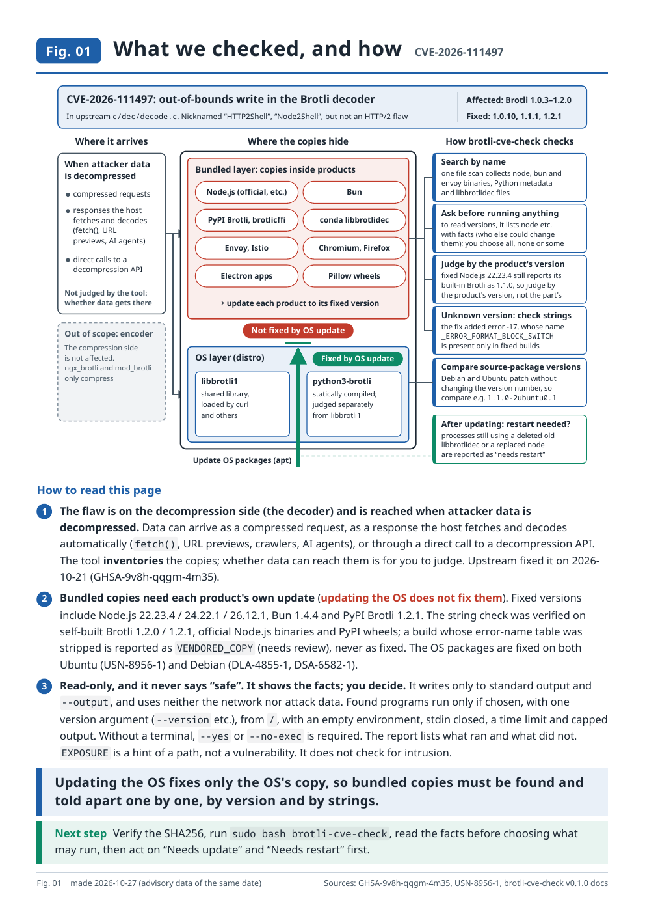
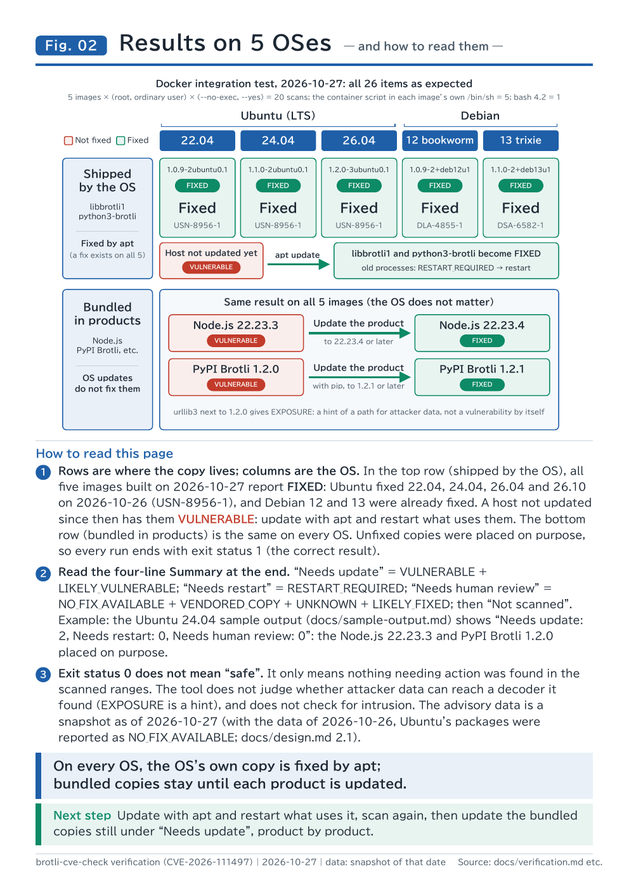

# brotli-cve-check

A read-only shell script that lists, on one Ubuntu or Debian host, the copies of the
Google Brotli **decoder** that may be affected by **CVE-2026-111497**
(out-of-bounds write in `c/dec/decode.c`, Brotli 1.0.3 to 1.2.0; fixed in 1.0.10, 1.1.1, 1.2.1).

Keywords: CVE-2026-111497, GHSA-9v8h-qqgm-4m35, Brotli decoder, "HTTP2Shell", "Node2Shell".
(Despite the nickname, this is not an HTTP/2 flaw.)

What the flaw is, which paths can carry attacker data to a decoder, and how to judge whether it
concerns you: [technical note by J-MEDIC Co., Ltd. (in Japanese)](https://www.jmedic.co.jp/pubdoc/http2shell_report_20261027.html). This tool is the
next step: it inventories one host.

日本語: [README.ja.md](README.ja.md) / 医療機関・中小企業の方へ: [docs/for-clinics.ja.md](docs/for-clinics.ja.md)
(Every document in docs/ has a Japanese version next to it as `*.ja.md`.)

## At a glance

<table>
<tr>
<td width="50%" valign="top"><a href="docs/zukai/01_check-method_en.pdf"></a></td>
<td width="50%" valign="top"><a href="docs/zukai/02_results-reading_en.pdf"></a></td>
</tr>
<tr>
<td><b>Fig. 01 What we checked, and how</b><br>Updating the OS fixes only the OS's copy; bundled copies are found and told apart by version and by strings.<br><a href="docs/zukai/01_check-method_en.pdf">PDF</a> · <a href="docs/zukai/01_check-method_en.html">HTML</a></td>
<td><b>Fig. 02 Results on 5 OSes, and how to read them</b><br>On every OS the OS's own copy is fixed by apt; bundled copies stay until each product is updated (as of 2026-10-27).<br><a href="docs/zukai/02_results-reading_en.pdf">PDF</a> · <a href="docs/zukai/02_results-reading_en.html">HTML</a></td>
</tr>
</table>

Japanese versions: [Fig. 01](docs/zukai/01_check-method_ja.pdf), [Fig. 02](docs/zukai/02_results-reading_ja.pdf).
Full results: [docs/verification.md](docs/verification.md).

## What it does, and what it does not

It **does**:

- check the distribution packages (`libbrotli1`, `python3-brotli`, ...) against the
  distributor's fixed versions;
- find the copies that updating the OS package does **not** fix: Node.js, Bun, PyPI
  `Brotli` / `brotlicffi`, conda, Envoy, curl builds, browsers, snap/flatpak apps,
  `libbrotlidec` files outside the package manager, and (with `--deep`) any ELF file that
  carries its own decoder;
- find processes that keep running the old code after an update (restart needed);
- give exposure hints (HTTP clients that decode Brotli automatically, listening sockets).

It is an **inventory** of decoder copies, not an exposure check.

It **does not**:

- decide whether attacker-controlled data can reach a decoder it found. Data can come in as a
  compressed request, as a response the host fetches and decodes automatically (`fetch()`, URL
  previews, crawlers, AI agents), or through a direct call to a decompression API; which of these
  apply to your services is for you to judge;
- check whether the host was compromised. Updating does not remove traces of an intrusion
  that happened before the update;
- scan other hosts, use the network, install, update, restart or change anything;
- generate, download or contain attack data;
- ever say "safe". The best result is "no known vulnerable component was found in the
  scanned ranges", followed by the list of ranges that were not scanned.

## Quick start

Do not pipe it into a shell. Download, verify, read, then run:

```sh
VERSION=v0.1.0
BASE=https://github.com/sakai-sktech/brotli-check/releases/download/$VERSION
curl -fsSLO "$BASE/brotli-cve-check"
curl -fsSLO "$BASE/SHA256SUMS"
sha256sum -c SHA256SUMS          # must print "brotli-cve-check: OK"
less brotli-cve-check            # read what you are about to run
bash brotli-cve-check            # as an ordinary user
sudo bash brotli-cve-check       # as root: also other users' processes and homes
```

Useful options:

```sh
bash brotli-cve-check --lang ja                     # Japanese output
bash brotli-cve-check --json --output report.json   # machine-readable (docs/json-schema.md)
sudo bash brotli-cve-check > report.txt             # as root, save the report via your own shell
bash brotli-cve-check --no-exec                     # never run any program it finds
sudo bash brotli-cve-check --yes > report.txt       # no questions: run the programs it lists
sudo bash brotli-cve-check --deep --containers      # slower, wider
bash brotli-cve-check --help
```

Requirements: bash 4.2 or later, coreutils, findutils, grep, sed, awk. binutils
(`readelf`) is optional; without it some linkage checks are less precise and the report says so.
No Python, no network.

## Before you use `--yes`

To read exact versions, the tool wants to run some of the programs it found, each with one
argument such as `--version`. At a terminal it first shows you the list — each program, and
who besides root or you could change it, a directory above it, or a library it loads — and
you choose: all, none, or by number. That list is the point: it is what you are deciding on.

`--yes` means "run everything on that list, without showing it to me first". It exists for
runs with no one at a terminal: a script, cron, a container. Use it knowing what you agree to:

- **A program runs with your rights.** With `sudo`, that means as root, with full control of
  the host. If a program on the list belongs to another user, or sits where another user can
  write, then that user decides what runs as root. The list says when this is the case
  ("belongs to alice", "can be written by anyone"); `--yes` agrees without reading it.
- **The list covers what can be seen before running**: the file, the directories above it,
  the libraries it loads. What a program opens once it is running (plugins, configuration
  files) is not on it.
- **A version that a program reports is only as trustworthy as the program.** The report's
  first section, "Programs run to read their versions", shows what ran, what it printed, and
  the facts. Read the findings with it: a FIXED that came from running a program others can
  change says what that program printed, nothing more.

If you are not sure, run once at a terminal and look at the list. For unattended runs where
nobody will read that section, `--no-exec` is the plain choice: nothing found is run, versions
come from files (headers, package records, paths, strings), and the report says what was not
run. For example: `sudo bash brotli-cve-check --no-exec --json > report.json`.

## Reading the result

Each finding is one line:

```
[STATUS] ID | component | where | version | reason | next step
```

| Status | Meaning | Next step |
|---|---|---|
| `VULNERABLE` | A known affected version | Update it (the line says to what) |
| `RESTART_REQUIRED` | The fix is on disk, but a process still runs the old code | Restart that process or service |
| `NO_FIX_AVAILABLE` | The distributor has not released a fix | Wait; meanwhile update the products that bundle their own copy |
| `VENDORED_COPY` | Carries its own decoder; the version could not be determined | Ask the vendor which Brotli it bundles |
| `LIKELY_VULNERABLE` / `LIKELY_FIXED` | Judged from the decoder's strings (verified heuristic, see below) | Confirm with the vendor |
| `UNKNOWN` | Could not be judged; the reason is always given | Read the reason |
| `EXPOSURE` | A path by which attacker data could reach a decoder; not a vulnerability by itself | Prioritize the updates it points to |
| `NOT_APPLICABLE` | No decoder in that file (for example a packaged compression-only module; a build of your own that merely shows no markers is `UNKNOWN`) | None for that file |
| `FIXED` | Contains the fix | None |

The report ends with four lines for non-specialists ("needs update", "needs restart",
"needs human review", "not scanned") and the intrusion disclaimer.

Exit status: `0` nothing needing action was found in the scanned ranges (not proof of
safety), `1` `VULNERABLE` or `RESTART_REQUIRED`, `2` something needs review
(`NO_FIX_AVAILABLE`, `VENDORED_COPY`, `LIKELY_*`, `UNKNOWN`), `3` error of the tool itself.

## How versions are judged

Version numbers are not trusted blindly:

- Debian and Ubuntu fix packages without changing the upstream version; the **source package
  version** (`1.1.0-2+deb13u1`) is compared with the distributor's fixed version.
- Fixed Node.js 22.23.4 still reports `process.versions.brotli` = `"1.1.0"`; that value is
  never used. Node.js is judged by its own version.
- `python3-brotli` from the distribution is compiled statically and judged separately from
  `libbrotli1`.
- For a bundled copy whose version is unknown, the decoder's error-name strings are used:
  the fix added `_ERROR_FORMAT_BLOCK_SWITCH` (error -17). This was verified on builds of
  1.2.0 and 1.2.1 (shared, static, LTO, stripped or not), on official Node.js binaries and on
  PyPI wheels ([tests/fixtures/c09/README.md](tests/fixtures/c09/README.md)). When the linker
  removed the error-name table, the copy is reported as `VENDORED_COPY`, never as fixed.
- To read exact versions the tool asks to run some programs it found with one version argument.
  **Before anything runs it lists them**, each with the facts that matter (who besides root or
  you could change the program, a directory above it, or a library it loads), and asks: all,
  none, or by number. Without a terminal, pass `--yes` or `--no-exec`. What ran, its output,
  and what did not are in the report. Programs not run are judged from files (headers,
  package records, paths, strings).
- A pre-release of exactly the fixed version (`1.4.4-rc.1`, Firefox `150.0a1`, ...) is not taken
  for the release; it is `UNKNOWN`.
- A version read from a file instead of the program (a directory name, a header, package
  metadata) gives `FIXED` only when the decoder's strings confirm the fix. Results from the
  strings say what was found and what could not be determined.

## Limitations

See [docs/limitations.md](docs/limitations.md). In short: copies inside archives and
images that are not running can be missed; without root, other users' processes and homes are
not visible; the advisory data is a snapshot.

## Advisory data and its date

All known versions live in [data/advisories.tsv](data/advisories.tsv), with the primary
source URL and the retrieval date on every row. The report shows the data's snapshot date and
warns when it is 30 days old or more. Newer data can be passed with `--data FILE`.
Snapshot: **2026-10-27**: every row's primary source was checked again on that date. Ubuntu fixed
22.04, 24.04, 26.04 and 26.10 on 2026-10-26 ([USN-8956-1](https://ubuntu.com/security/notices/USN-8956-1));
Debian 12, 13 and unstable are fixed, and testing (forky) was still waiting for the fix to migrate.

Note: Red Hat advisories RHSA-2026:2042 / 2227 / 2389 are about a different issue
(CVE-2025-6176). Updating `pip` or `certifi` is unrelated to this CVE (CPython itself does
not contain Brotli).

## Development

```sh
make lint          # shellcheck, zero warnings
make test          # bats unit tests
make dist          # dist/brotli-cve-check (single file) and dist/SHA256SUMS
make integration   # Ubuntu 22.04/24.04/26.04 and Debian 12/13 containers (needs docker)
```

Verification results: [docs/verification.md](docs/verification.md). Sample output:
[docs/sample-output.md](docs/sample-output.md). Design notes: [docs/design.md](docs/design.md). Contributing:
[CONTRIBUTING.md](CONTRIBUTING.md). Security issues in this tool: [SECURITY.md](SECURITY.md).

## Disclaimer

Provided "as is", without warranty (see [LICENSE](LICENSE)). A result is only as good as
the ranges scanned and the data's date; it does not prove that a host is safe.

## License

MIT. Copyright (c) 2026 株式会社ジェイ・メディック.
